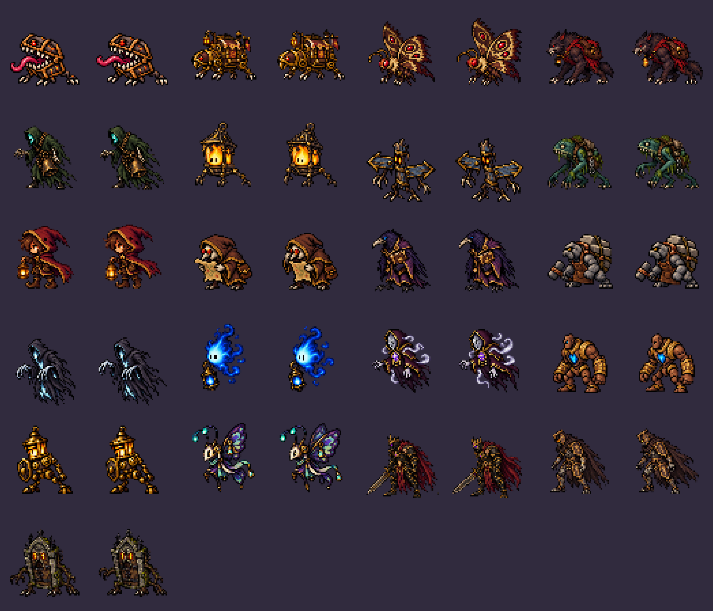
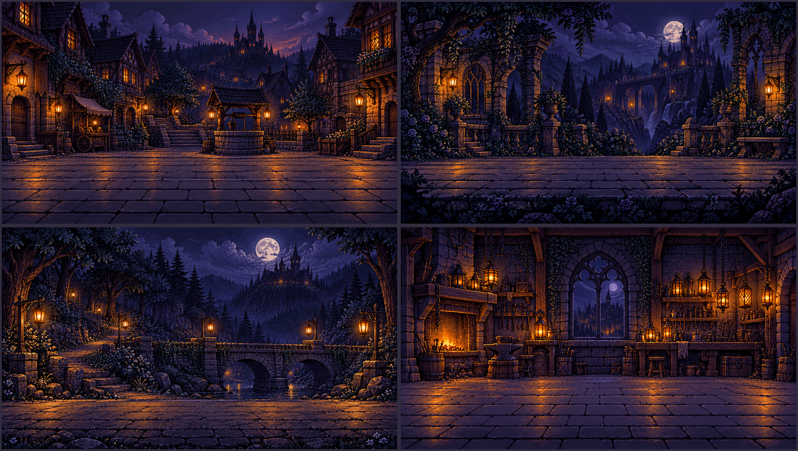
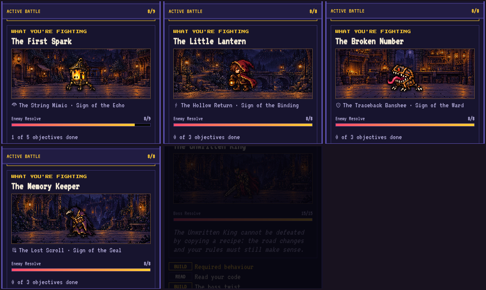
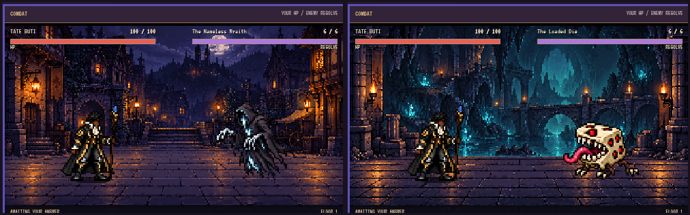
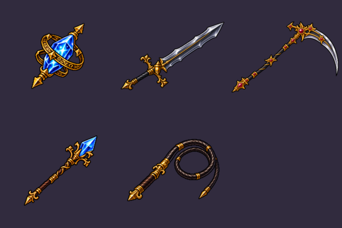
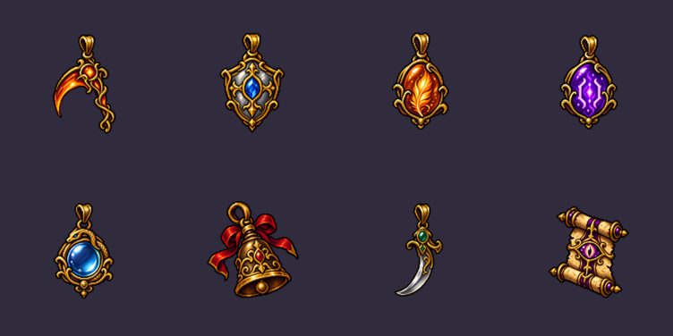
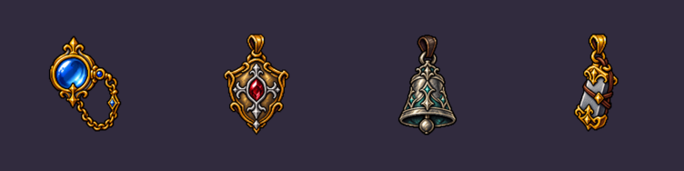

# Combat art — review sheet

Local work on `feature/tauri-arcade`. Nothing here has been pushed. The user save was not used for the browser tests.

## Chapter 1: Lantern Vale

Each of the 20 contracts and the Unwritten King has a two-frame idle portrait. The four acts use the village, road, workshop and overgrown vale respectively. The Forge examples are from isolated campaign fixtures; the boss image is darkened by the boss gate overlay.

## Infinite Dungeon: first two regions

The combat stage switches with the chosen region and uses a distinct animated creature for each of the first two region rosters and their bosses. These images show actual first-gate encounters in an isolated browser session.

## Equipment

Home equipment styles have separate staff, whip, greatsword, scythe and hand-magic focus icons; the selected style is reflected in sparring. Lantern Vale's five weapons, five trinkets and crown relic also have item icons. Existing campaign trinkets have their own icons in the market and loadout.

The first dungeon regions also have distinct run-trinket icons. Dungeon shops and inventory display these alongside matching weapon-type art.

## Verification and limits

The art mapping checks, frontend build, Godot animation and live-bridge smoke checks, and focused weapon/armory tests passed. In Chromium, isolated Basics Village and Collection Caves runs exercised incorrect and correct submissions using a **deterministic test-only judge**: misses triggered enemy attacks and HP loss; correct verdicts cleared the encounter and played the hunter attack. This does not test the quality or availability of an actual AI grader. The full tutorial campaign has not been played through end-to-end. The Forge tutorial portraits have idle animation; their generated attack concepts are not currently campaign combat animations. See [the work log](COMBAT_ART_WIP.md) for details.
